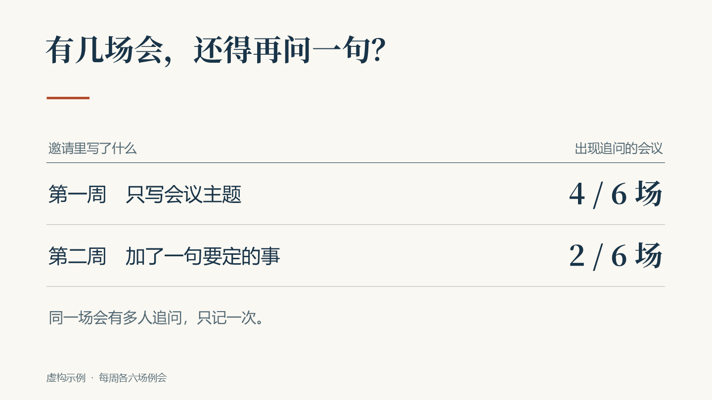

# 见稿 · JianGao

给要讲中文 PPT 的人。可以从一篇论文、一份周报或一个想讲给朋友的故事开始，也可以直接拿已有的图片稿来改。

新稿先写清每页要讲什么，再用 GPT 内置 ImageGen 画完整样页。风格定下来以后逐页生图，由 PPT Master 按图还原成 PowerPoint。下次老师说“把这一项系数改一下”，可以直接找到对应单元格。

## 先看一页

这场虚构的三分钟午间分享问了一个小问题：会议邀请多写一句“要定什么”，还有多少人需要追问？下面是三页示例的第二页，截图来自实际 PowerPoint。两行计数放在一张原生表格里。这个下载件专门演示局部编辑；配套脚本里另有同一页的完整 ImageGen 提示词。



[下载三页可编辑示例](examples/lunch-talk.pptx) · [阅读三页脚本和生图提示词](examples/lunch-talk.md) · [试改示例中的一个数字](skills/jiangao-slides/references/edit-and-check.md)

## 安装到 Codex

在 Codex 里发：

```text
请使用 $skill-installer，从 https://github.com/Henry369-0/jiangao-slides/tree/main/skills/jiangao-slides 安装「见稿」。
```

需要把整页图还原成 PPTX 时，另行安装 Hugo He 的 PPT Master，并按上游说明配置其运行依赖。生图需要当前会话提供 GPT 内置 ImageGen 和看图能力。读论文、校口述稿、检查现有 PPTX 的对象可以单独进行。Windows 桌面 PowerPoint 仅用于仓库附带的原生单元格试改脚本。[PPT Master 官方安装说明](https://github.com/hugohe3/ppt-master#readme) · [官方 Image to PPTX 流程](https://github.com/hugohe3/ppt-master/blob/main/skills/ppt-master/workflows/profiles/image-to-pptx.md)

## 第一次可以这样说

| 场合 | 发给 Codex 的一句话 |
| --- | --- |
| 毕业答辩 | 用 $jiangao-slides 把这篇论文做成十分钟答辩。讲透研究怎么做、图表怎么读；老师最可能问的那一步放在正文。 |
| 工作汇报 | 用 $jiangao-slides 做本月经营复盘。附件有目标和实际值，希望会上能定下个月先改哪件事。 |
| 个人分享 | 用 $jiangao-slides 把这段经历做成给朋友讲的五分钟分享。先给我看一张有内容的样页，我想自己选方向。 |
| 局部改稿 | 只改第 2 页表格右下角的数据。另存副本，把改前改后的画面给我看。 |

只给用途和材料，见稿会自行选样页和风格。想参与某一步，直接说“先看脚本”或“先看两个样页”。指定学院或单位母版时，沿用你提供的原件。

## 见稿管哪几步

1. **材料与讲稿。** 答辩把结论接到原文图表，汇报把差距接到决策，分享从一个具体情境讲起。每页分别写观众看到的文字和讲者开口说的话。生图之前先念一遍，改掉听起来像在念提纲的句子。[三种场合的口述改写](skills/jiangao-slides/references/spoken-chinese.md)
2. **样页与风格。** 从最难讲的内页试画。定好图注、字号层级和颜色含义，再按各页内容换构图。六个公开参考直接指向可翻看的原作位置。[按场合看参考](skills/jiangao-slides/references/visual-references.md)
3. **还原与验收。** 图像生成负责画面，PPT Master 负责按图还原。表格和需要改数的图表优先用原始数据重建。交付原图与 PPTX，在副本里试改、重开、逐页比对。复杂插画或缺少底层数值的原刊图可以作为独立图片保留。[查看完整技能](skills/jiangao-slides/SKILL.md)

[原创内容与第三方作品的使用说明](RIGHTS.md)
